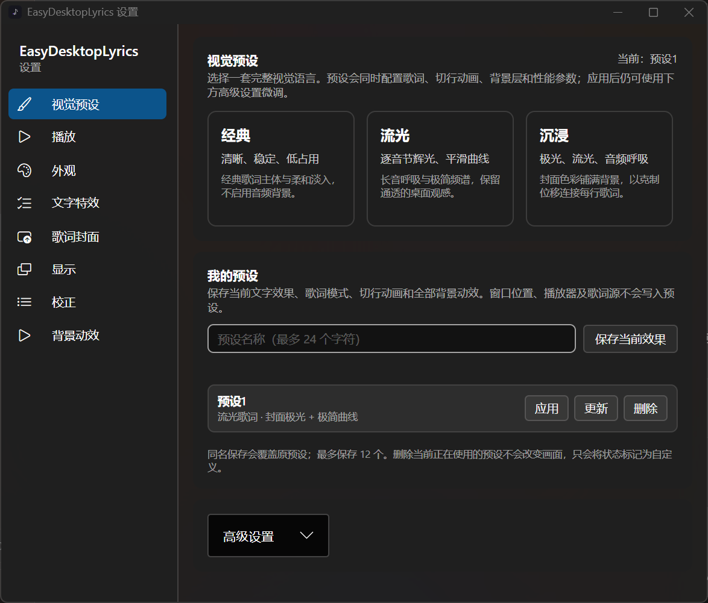
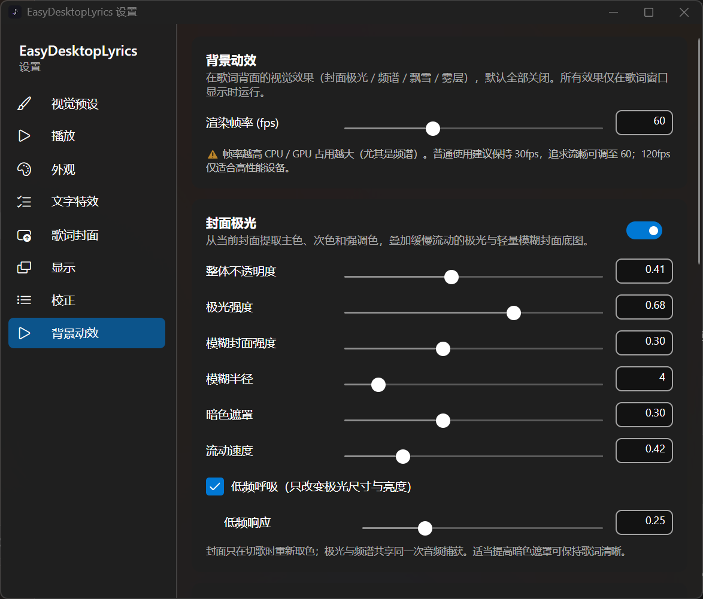

<p align="center">
  
</p>

<h1 align="center">EasyDesktopLyrics</h1>

<p align="center">
  面向 Windows 的轻量桌面歌词软件：跟随系统媒体会话同步歌词，并提供逐字流光、封面极光、音频频谱和可组合动画。
</p>

<p align="center">
  
  
  
  
  <a href="LICENSE"></a>
</p>

EasyDesktopLyrics 通过 [SMTC](https://learn.microsoft.com/windows/uwp/audio-video-camera/system-media-transport-controls) 跟随 Spotify、网易云音乐、QQ 音乐、Apple Music、foobar2000 等播放器。歌词窗口可以常驻桌面，锁定后完全鼠标穿透，不影响其他窗口操作。


## 分支修改内容
- 修复歌词窗口会在Alt + Tab出现的问题
- 优化歌词描边绘制
- 禁用 ClearType 亚像素渲染
- 本地歌词支持翻译行，逐字
- 歌词外观新增渐变上和下
- 新增软件日志级别设置
- 优化部分内存占用
- 优化歌词状态
- 修复修改歌词字体时，下次启动时异常导致软件全部字体替换为歌词字体的问题


## 界面预览

### 桌面歌词

封面极光、流光歌词与音频驱动的极简曲线可以自由组合：


| 普通歌词与翻译 | 常驻封面与逐字高亮 | 悬停播放控制 |
|:---:|:---:|:---:|
|  |  |  |

### 视觉设置

| 内置与用户视觉预设 | 封面极光设置 |
|:---:|:---:|
|  |  |

设置界面仍保留文字、封面、显示、校正和背景动效等独立页面，适合在预设基础上继续微调：


## 动效演示

| 位移淡入 | 缩放弹入 |
|:---:|:---:|
|  |  |

| 扫光 | 切歌动画 |
|:---:|:---:|
|  |  |

## 3.0 新特性

- **流光歌词**：按音节点亮双层柔光；长音持续呼吸，结束后平滑消散。无精确逐字数据时会自动降级，不伪造错误时间轴。
- **封面极光**：缓存提取封面的主色、次色和强调色，生成缓慢流动的极光、轻量模糊底图与低频呼吸；整体透明度可独立控制。
- **音频特征共享**：频谱、极简曲线和背景呼吸共用一次 WASAPI/FFT 分析，窗口隐藏时停止工作；采集不可用时自动回退模拟效果。
- **视觉预设**：内置“经典 / 流光 / 沉浸”三套方案，并支持保存、应用、更新或删除最多 12 套用户预设。
- **稳定动画布局**：封面动画始终围绕稳定中心运行，修复切歌错位、窗口漂移、常驻封面延迟显示和辉光矩形裁剪等问题。
- **精确歌词时间轴**：保留逐字歌词中的开始时间与持续时间，使长音辉光、逐字推进和播放进度保持一致。

## 功能

| 功能 | 说明 |
|------|------|
| **SMTC 同步** | 自动跟随任何发布 Windows 系统媒体会话的播放器；多播放器同时运行时可配置跟随优先级和忽略列表 |
| **多源歌词** | 网易云音乐、QQ 音乐、LRCLIB 与本地 LRC 目录自动匹配，来源顺序可配置 |
| **逐字与翻译** | 支持精确逐字高亮、整行歌词自动降级和翻译行；可分别调整字号、颜色、行距与不透明度 |
| **歌词视觉模式** | 经典模式保持清晰稳定；流光模式增加当前音节辉光、长音呼吸和释放余辉 |
| **文字效果** | 已唱和未唱部分可分别配置颜色、描边、阴影与柔和辉光，文字主体与发光层独立绘制 |
| **视觉预设** | 一键应用经典、流光、沉浸方案；用户预设只保存视觉设置，不改变窗口位置、播放器规则和歌词来源 |
| **行间动画** | 淡入、位移、缩放、交叉淡化、逐字显现和扫光；支持速度、缓动、方向、距离与模糊微调 |
| **封面极光** | 封面取色、渐变极光、模糊底图、暗色遮罩、流动速度、低频响应及整体透明度 |
| **音频频谱** | 柱状、曲线、单曲线和极简曲线；支持镜像布局、位置、数量、强度、颜色、辉光和低频呼吸 |
| **其他背景** | 可独立组合飘雪与雾层；所有背景效果均只在歌词窗口显示时运行 |
| **歌词封面** | 常驻封面与切歌封面动画彼此独立；支持尺寸、方向、时长、透明度和缓动设置 |
| **窗口控制** | 锁定后鼠标穿透；支持九宫格定位、位置微调、托盘控制、开机自启和暂停时隐藏 |
| **播放控制** | 鼠标悬停显示上一曲、播放/暂停和下一曲按钮，通过 SMTC 控制当前播放器 |
| **时间校正** | 支持单曲歌词源手动指定、单曲偏移与全局时间偏移 |

## 下载与使用

在 [Releases](https://github.com/Zydr114/EasyDesktopLyrics/releases) 中，每个版本提供两种 Windows x64 软件包：

| 软件包 | 适用场景 |
|------|------|
| `EasyDesktopLyrics-<版本>-win-x64.zip` | **框架依赖版**，约 18 MB；需要预先安装 [.NET 10 Runtime](https://dotnet.microsoft.com/download/dotnet/10.0) |
| `EasyDesktopLyrics-<版本>-win-x64-standalone.zip` | **自包含单文件版**，约 48 MB；已包含运行时，解压即可使用 |

1. 下载并解压其中一种软件包。
2. 双击 `EasyDesktopLyrics.exe`。
3. 打开支持 SMTC 的播放器并开始播放，歌词窗口会自动显示。
4. 通过托盘菜单或设置锁定歌词，使窗口进入鼠标穿透状态。

首次获取的歌词会缓存在 `%APPDATA%\EasyDesktopLyrics\cache\lyrics\`。如需开机启动，可在“设置 → 显示”中开启。

## 歌词来源

- **网易云音乐**：搜索、LRC、逐字 YRC 与翻译，无需登录。
- **QQ 音乐**：搜索、LRC 与翻译。
- **LRCLIB**：开放社区歌词库，对欧美和日韩歌曲覆盖较好。
- **本地目录**：扫描指定文件夹中的 `*.lrc`，按歌曲名与歌手自动匹配。

自动匹配不理想时，可以在校正页面手动选择歌曲或调整歌词偏移。删除歌词缓存后，会在下次播放时重新获取。

## 从源码构建

要求：Windows 10 2004+、.NET 10 SDK。

```powershell
git clone https://github.com/Zydr114/EasyDesktopLyrics.git
cd EasyDesktopLyrics
dotnet build -c Release

# 框架依赖版
dotnet publish -c Release -r win-x64 --self-contained false

# 自包含单文件版
dotnet publish -c Release -r win-x64 --self-contained true `
  -p:PublishSingleFile=true `
  -p:EnableCompressionInSingleFile=true
```

## 隐私

- 应用不收集或上传使用数据。
- 开机自启默认关闭，仅在用户主动开启设置后注册。
- 在线歌词来自对应平台或社区提供的接口，仅供个人使用；请遵守相关平台条款。

## 致谢

- [BetterLyrics](https://github.com/jayfunc/BetterLyrics)：为逐音节发光、音频可视化和极简背景效果提供视觉灵感。
- [Folia](https://github.com/chthollyphile/folia-major)：为歌词视觉模式、时间轴和效果分层提供架构思路。

EasyDesktopLyrics 仅参考上述项目公开展示的视觉理念与效果组织方式，项目实现均基于 C#、Avalonia 与 Skia 独立完成。

## 第三方依赖

- [Avalonia](https://github.com/AvaloniaUI/Avalonia)（MIT）：跨平台 UI 框架。
- [FftSharp](https://github.com/swharden/FftSharp)（MIT）：频谱 FFT 分析。

## License

[MIT](LICENSE)
